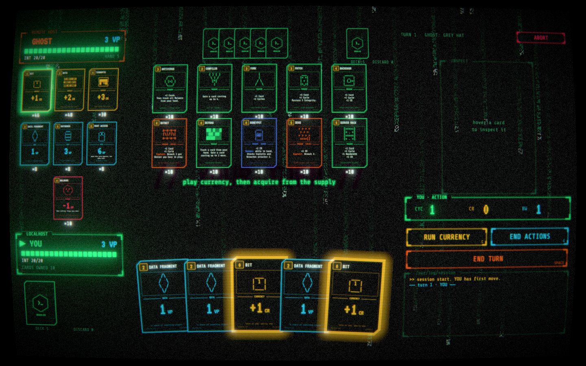

# BREACH.EXE

Play: [https://breach.codybarr.dev](https://breach.codybarr.dev)



## Tech

- TypeScript, Three.js, Vite
- Bun HTTP/WebSocket server
- Vitest, Playwright

## Setup & run

Install [Bun](https://bun.sh), then:

```sh
bun install
bun run serve
```

Open http://localhost:8080. This builds the game and starts the multiplayer server.

For development with hot reload, run these in separate terminals:

```sh
bun run server
bun run dev
```

Open http://localhost:5173.
